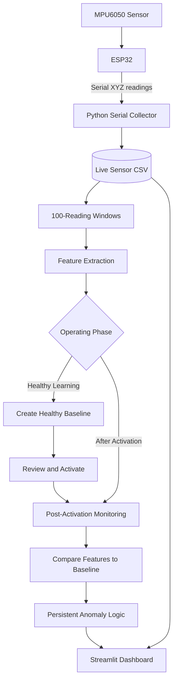

<div align="center">

# ⚙️ VibeGuard AI

### Live AI-IoT Predictive Maintenance for Motor Vibration

**Sense continuously. Learn healthy behavior. Flag persistent changes.**


*A hardware-connected condition-monitoring prototype that learns a motor's healthy vibration profile and compares subsequent sensor windows against that reference.*

</div>

---

## ✨ Overview

**VibeGuard AI** is an AI-IoT predictive-maintenance prototype that monitors motor vibration using an ESP32 and an MPU6050 accelerometer module.

Sensor readings are streamed to a Python collector, processed into vibration features, and visualized through a Streamlit dashboard. A healthy baseline is created first; after that baseline is reviewed and activated, subsequent readings are analyzed for unusual vibration patterns.

The goal is to demonstrate how embedded sensing, real-time data processing, anomaly detection, and a live dashboard can work together in a practical industrial-monitoring workflow.

> **Safety notice:** An anomaly indicates unusual vibration, not a confirmed mechanical fault. This prototype is intended for learning and demonstration, not as a safety-rated industrial protection system.

## 🚀 Key Features

- **Live vibration acquisition** from an ESP32 connected to an MPU6050.
- **Serial data collection** using Python and PySerial.
- **Healthy-baseline learning** from a verified healthy operating condition.
- **Versioned baseline management** with review and explicit activation.
- **Window-based feature extraction** from three-axis acceleration data.
- **Baseline-relative anomaly detection** using learned feature ranges.
- **Persistent anomaly alerts** to avoid treating every isolated unusual window as a recurring fault.
- **Live Streamlit dashboard** with vibration charts, anomaly scores, status indicators, and recent monitoring windows.
- **Timestamp-aware monitoring** to separate baseline learning from post-activation detection.

## 🧭 System Architecture



## ⚙️ How It Works

### 1. Sensor acquisition
The MPU6050 measures acceleration on the X, Y, and Z axes. The ESP32 reads the sensor and sends comma-separated readings over serial.

### 2. Data collection
The Python serial collector parses incoming readings, converts raw acceleration counts to g according to the configured sensor range, and appends timestamped rows to a CSV file.

### 3. Healthy-baseline learning
The motor is operated under a verified healthy condition during the configured 30-second learning interval. The collected readings are divided into fixed-size windows, and statistical features are calculated.

### 4. Baseline review and activation
A baseline is saved as a versioned JSON file. It must be reviewed and explicitly activated before it is used for monitoring. The registry records the activation timestamp.

### 5. Live anomaly detection
Only readings received after baseline activation should enter post-activation monitoring. Each complete window is compared with the healthy baseline's feature ranges.

The current detector flags a window when at least three features deviate beyond their allowed ranges. A persistent alert is raised when at least three of the latest five monitoring windows are anomalous.

### 6. Dashboard visualization
The dashboard presents live vibration signals, monitoring-window results, anomaly scores, and the current status. The display refreshes as new sensor data arrives.

## 🧰 Technology Stack

| Layer | Technology | Purpose |
|---|---|---|
| Embedded hardware | ESP32 | Sensor acquisition and serial output |
| Sensor | MPU6050 / GY-521 | Three-axis acceleration |
| Programming | Python | Collection and processing |
| Serial communication | PySerial | ESP32-to-computer communication |
| Data processing | NumPy, pandas | Windowing and feature extraction |
| Visualization | Plotly | Interactive charts |
| Dashboard | Streamlit | Live monitoring interface |
| Baseline storage | JSON | Baseline versions and activation registry |
| Version control | Git, GitHub | Source-code management |

## 📁 Project Structure

```text
AI-IOT_Predictive_Maintenance/
├── dashboard/
│   └── app.py
├── src/
│   ├── __init__.py
│   ├── serial_collector.py
│   ├── features.py
│   ├── baseline_learning.py
│   ├── baseline_registry.py
│   └── baseline_monitor.py
├── data/
│   ├── processed/
│   │   └── live_sensor_data.csv
│   ├── baselines/
│   │   └── MOTOR_001/
│   └── sample/
│       └── sample_vibration.csv
├── docs/
│   ├── architecture.md
│   ├── wiring.md
│   └── testing.md
├── models/
├── requirements.txt
├── .gitignore
└── README.md
```

Generated live data and machine-specific baseline files should normally remain local. The sample CSV is provided for illustration and is not a replacement for live sensor data.

> **Firmware note:** Add your tested ESP32 sketch under `firmware/esp32_sensor/` before publishing if you want others to reproduce the hardware setup end to end.

## 🛠️ Getting Started

### Prerequisites

- Python 3.11 or newer recommended
- Git
- ESP32 development board
- MPU6050 / GY-521 module
- USB data cable and jumper wires
- Arduino IDE or another compatible firmware development environment

### 1. Clone the repository

```bash
git clone https://github.com/YOUR_USERNAME/AI-IoT-Predictive-Maintenance.git
cd AI-IoT-Predictive-Maintenance
```

Replace `YOUR_USERNAME` with your GitHub username.

### 2. Create a virtual environment

**Windows PowerShell**

```powershell
python -m venv .venv
.\.venv\Scripts\Activate.ps1
```

**macOS / Linux**

```bash
python3 -m venv .venv
source .venv/bin/activate
```

### 3. Install dependencies

```bash
python -m pip install --upgrade pip
pip install -r requirements.txt
```

### 4. Connect the sensor

For the documented ESP32 DevKit setup:

| MPU6050 pin | ESP32 pin |
|---|---|
| VCC | 3V3 |
| GND | GND |
| SDA | GPIO 21 |
| SCL | GPIO 22 |

See [docs/wiring.md](docs/wiring.md) for wiring notes and the serial data format.

### 5. Configure the serial collector

Open `src/serial_collector.py` and configure the serial port to match your ESP32, for example `COM5` on Windows.

The documented collector expects serial readings in this format:

```text
ax_raw,ay_raw,az_raw
```

It uses a baud rate of 115200 and assumes an MPU6050 accelerometer range of ±2 g, with raw counts converted using `raw / 16384.0`. Verify these settings against your firmware.

### 6. Start the sensor collector

Open terminal 1 from the project root:

```bash
python -m src.serial_collector
```

Keep the collector running so new sensor readings continue to arrive.

### 7. Launch the dashboard

Open terminal 2 from the project root:

```bash
streamlit run dashboard/app.py
```

Open the local URL printed by Streamlit, typically:

```text
http://localhost:8501
```

### 8. Learn and activate the baseline

1. Verify the motor is operating in a healthy and representative condition.
2. Confirm the healthy-operation checkbox in the dashboard.
3. Start the 30-second learning process.
4. Keep the motor, sensor mounting, and collector running throughout learning.
5. Review and activate the resulting baseline.
6. Confirm that post-activation monitoring begins only after activation.
7. Observe live vibration data and anomaly results.

Do not learn a baseline while a motor is damaged, unsafe, or operating under conditions that are not representative of normal operation.

## 📊 Vibration Features

Each complete 100-reading window produces four features for each of the three acceleration axes:

- RMS
- Standard deviation
- Absolute peak
- Peak-to-peak range

This produces **12 features per window**.

The baseline stores summary statistics, including the fifth and ninety-fifth percentiles (P05 and P95). Live feature values are compared with those learned ranges using a configurable margin.

## 🧪 Testing and Validation

Before demonstrating the project, verify:

- The ESP32 is sending valid readings.
- The collector continuously appends data.
- The healthy baseline is created and activated successfully.
- Learning-period readings are excluded from post-activation anomaly results.
- The monitoring window count advances as new complete windows arrive.
- One anomalous window does not trigger a persistent-fault alert.
- Three anomalous windows among the latest five trigger the configured persistent alert.
- Stopping the collector or disconnecting the sensor produces a clear waiting/error state.
- The dashboard's current status agrees with the monitor's output.

See [docs/testing.md](docs/testing.md) for a detailed validation checklist.

**Do not claim a measured detection accuracy or industrial fault-detection rate unless it has been evaluated against labelled ground-truth data.**

## 📚 Documentation

- [System architecture](docs/architecture.md)
- [Sensor wiring](docs/wiring.md)
- [Testing and validation](docs/testing.md)

## 🔒 Data and Security

- Do not commit virtual environments, secrets, credentials, or private machine data.
- Keep generated live sensor logs out of Git unless a specific sanitized sample is needed.
- Treat baseline JSON files as machine-specific reference data.
- Commit only sample data that is safe to publish.
- Never commit passwords, API keys, tokens, or private configuration files.

## ⚠️ Scope and Limitations

- This is a prototype for learning and portfolio demonstration, not a certified industrial monitoring product.
- Sensor mounting, motor speed, load, and environmental conditions affect vibration measurements.
- Baseline quality depends on the health and representativeness of the recorded motor operation.
- An anomaly indicates a deviation from the learned baseline; it does not identify a root cause.
- The thresholds must be validated against known healthy and fault conditions before real-world deployment.
- Hardware disconnection, timestamp behavior, and stale-data handling should be tested explicitly.

## 🛣️ Roadmap

- [ ] Include the tested ESP32 firmware sketch.
- [ ] Add automated unit tests for feature extraction and baseline lifecycle.
- [ ] Add reproducible tests for the persistent-anomaly rule.
- [ ] Add explicit stale-data and sensor-disconnection indicators.
- [ ] Record timestamped test runs for known healthy and simulated anomalous conditions.
- [ ] Add continuous integration and dependency checks.
- [ ] Evaluate against labelled vibration data before making performance claims.

## 👨‍💻 Author

Arya Rajan Zad

- GitHub: https://github.com/aryazad-28
- LinkedIn: www.linkedin.com/in/arya-zad

<div align="center">

**Built at the intersection of embedded systems, data engineering, and applied AI.**

</div>
