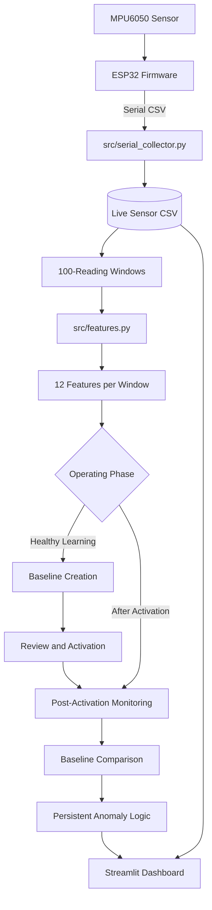

# System Architecture

## 1. Data Flow

## 2. Module Responsibilities

| Module | Responsibility |
|---|---|
| `src/serial_collector.py` | Reads serial sensor data, converts raw acceleration counts to g, and appends timestamped readings to CSV. |
| `src/features.py` | Extracts vibration features from fixed-size windows. |
| `src/baseline_learning.py` | Validates healthy-operation data and creates versioned baseline JSON files. |
| `src/baseline_registry.py` | Reviews and activates baselines and records activation metadata. |
| `src/baseline_monitor.py` | Compares post-activation windows against the active baseline and tracks recurring anomalies. |
| `dashboard/app.py` | Displays baseline controls, vibration signals, anomaly scores, and monitoring status. |

## 3. Windowing and Features

The documented configuration uses 100 readings per window.

For each acceleration axis (`ax_g`, `ay_g`, `az_g`), four features are extracted:

- RMS
- Standard deviation
- Absolute peak
- Peak-to-peak range

This gives 12 features per complete window.

## 4. Baseline Lifecycle

1. Collect readings while the motor is verified healthy.
2. Build a baseline from the designated learning interval.
3. Save the baseline as a versioned JSON file.
4. Review the baseline.
5. Activate the selected baseline and record `activated_at_utc`.
6. Monitor only readings received after activation.

The monitoring boundary should use the collector's `received_timestamp`, not an elapsed-time value that may reset or be estimated.

## 5. Anomaly Logic

The current implementation compares feature values with stored P05/P95 ranges and a configurable margin.

A window is classified as anomalous when at least three features deviate beyond their allowed ranges. A persistent alert is configured when at least three of the latest five monitoring windows are anomalous.

These thresholds must be validated against known healthy and fault examples.

## 6. Operational Assumptions

- The ESP32 sends three comma-separated numeric raw acceleration values per sample.
- The serial baud rate is 115200 unless configured otherwise.
- The collector assumes ±2 g accelerometer scaling (`raw / 16384.0`).
- The motor and sensor conditions remain representative between learning and monitoring.
- The tested ESP32 firmware should be included in the repository for end-to-end reproducibility.

## 7. Limitations

This architecture demonstrates a predictive-maintenance workflow but is not a certified industrial safety system. Anomaly detection indicates deviation from a learned reference; it does not independently prove a mechanical fault or diagnose its root cause.
